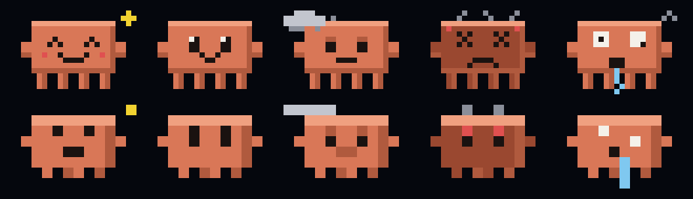

# claude-compact-statusline

A compact, boxed status line for [Claude Code](https://claude.com/claude-code), and an
optional upgrade, [clawd-meter](clawd-meter/): a pixel-art mascot above the prompt
with a context trend, turn activity and a speech bubble. The status line is one Python
file, standard library only, no Nerd Font required.



```
╭─ Fable 5.1 ──────────────────────────────────────────────────── 05:03 ╮
│ █████████████░░░░░░░░░░░░░░░░░░░░░░░░░░  37% 371k/1.0M sharp (^‿^) │
│ …/services/keep                                         master ~4 ?8 │
│ $23.16 · 4h41m                                               +296 -1 │
╰──────────────────────────────────────────────────────────────────────╯
```

Four rows: model and clock; context fill; directory and git state; cost,
session time and lines changed. Below those, up to two rows list the plugins
enabled for the session (user and project settings) and the project's MCP
servers, so what is armed is always in view. Every row is laid out for a narrow phone
terminal first and only spreads out when there is room, so the same file
works in a 48-column phone terminal and a wide desktop terminal.

## The scale

The context bar is labelled by how much headroom the model has left:

| Context used | Word     | Face    |
|-------------:|----------|---------|
| under 40%    | sharp    | `(^‿^)` |
| 40 to 60%    | coasting | `(•‿•)` |
| 60 to 75%    | foggy    | `(•_•)` |
| 75 to 90%    | cooked   | `(x_x)` |
| 90% and up   | dumb     | `(°﹃°)` |

The face is the first thing dropped when the row gets narrow, then the
word, then the token counts. The bar never shrinks below ten cells.

## Install

Pick one, at the prompt of a Claude Code terminal session. Each adds this repo as a
plugin marketplace (answer `y`, then choose a scope; user is first).

| You want | Run |
|---|---|
| **The status line**, with its ASCII mascot | `/plugin install compact-statusline --marketplace Aypex-agent/claude-compact-statusline` |
| **Status line + clawd-meter** | `/plugin install clawd-meter --marketplace Aypex-agent/claude-compact-statusline` |
| **clawd-meter on top of an installed status line** | the same `clawd-meter` line: the status line is its dependency, already there |

From a shell, the same with `claude plugin install …` in place of `/plugin install …`.
Start a new session afterwards.

Plugins can't declare a status line, so `compact-statusline` sets it for you: a SessionStart
hook points `statusLine` in `~/.claude/settings.json` at the plugin's copy of `compact.py`,
and repoints it when an update moves the plugin. It only does so when `statusLine` is unset
or already runs a `compact.py` (an earlier hand install included), and it keeps any
`VAR=value` prefixes you put on the command. Someone else's status line is left alone, with
a one-time note saying what to set. Your settings as they were go to
`~/.claude/compact-statusline/settings.json.before-compact-statusline` the first time it
writes. `COMPACT_STATUSLINE_MANAGE=0` turns this off. After uninstalling, remove the
`statusLine` entry yourself.

With clawd-meter enabled, the status line hides its ASCII face, since the pixel mascot
shows the band (`PHONE_SL_FACE=1` keeps it).

### By hand, without the plugin system

```sh
curl -fsSLo ~/.claude/statusline/compact.py \
  https://raw.githubusercontent.com/Aypex-agent/claude-compact-statusline/main/compact.py
```

Then point Claude Code at it in `~/.claude/settings.json`:

```json
{
  "statusLine": {
    "type": "command",
    "command": "python3 ~/.claude/statusline/compact.py",
    "padding": 0
  }
}
```

Needs `python3` and `git` on `PATH`. Git rows are skipped outside a repo.

## Width and colours

The box fills the terminal. Claude Code runs the status line without a tty and passes
the terminal width in `$COLUMNS`, so the box grows and shrinks with the window.

When an [Omarchy](https://omarchy.org) theme is active, the accent, frame and band colours
come from `~/.local/state/omarchy/current/theme/colors.toml` as truecolor and follow theme
switches. Without one (the phone, or any other machine) it uses plain ANSI with a cyan accent,
which the terminal maps to its own palette.

## Tuning

All optional, set in the environment the status line command runs in
(for example by prefixing them in the `command` string above):

| Variable          | Default | Effect                                              |
|-------------------|--------:|-----------------------------------------------------|
| `PHONE_SL_WIDTH`  | auto    | Force the box width instead of detecting the tty    |
| `PHONE_SL_MAX`    | `0`     | Width cap; `0` fills the terminal. The original phone build used `72` |
| `PHONE_SL_THEME`  | `auto`  | `ansi` ignores the Omarchy theme and keeps the plain ANSI palette |
| `PHONE_SL_THEME_FILE` | Omarchy's | Path to a `colors.toml` to take colours from |
| `PHONE_SL_MARGIN` | `4`     | Columns left free for Claude Code's own indent      |
| `PHONE_SL_FACE`   | auto    | `0` hides the face and keeps just the word; `1` keeps it. Unset, it hides while clawd-meter is enabled |
| `PHONE_SL_TOOL_ROWS` | `2`  | Max rows for the plugin and MCP list; `0` hides it  |

## Origin

Written as the status line for a Claude Code instance living in a proot
container on a phone, where every column counts. It turned out to be less
cluttered than the full-width alternatives on the desktop too, so it moved
there as well. The layout is inspired by
[yas](https://github.com/tmck-code/yet-another-statusline).

## License

MIT. See [LICENSE](LICENSE).
