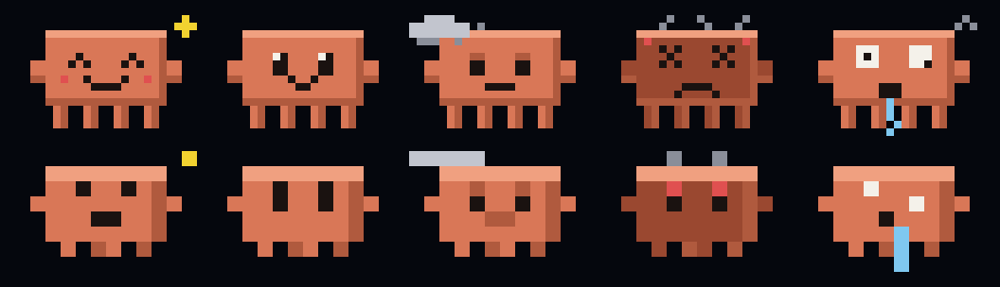

# clawd-meter

A Claude Code mod that puts a small pixel-art mascot, a fan-made take on the orange
Claude mascot, right-aligned in the band above the prompt. Its expression follows how full
the context window is, on the same scale as
the [compact status line](../):

| Context used | Band     |
|-------------:|----------|
| under 40%    | sharp    |
| 40 to 60%    | coasting |
| 60 to 75%    | foggy    |
| 75 to 90%    | cooked   |
| 90% and up   | dumb     |



## The band

Left of the mascot, the band fills in as there's room. Narrowing drops one block at a time
(activity first, then the trend, then the bubble), so it works from a phone terminal up:

| Band width | Shows |
|---|---|
| 84+ columns | trend, activity, bubble, mascot |
| 60–83 | trend, bubble, mascot |
| 32–59 | bubble, mascot |
| under 32 | mascot only |

When the band has fewer than 4 rows (a phone with its on-screen keyboard up, say), it switches to
one right-aligned line: the bubble's text cut to fit, then the band's face, e.g. `cruising. (•‿•)`.

- **Context trend:** a sparkline of context fill at the end of each turn, coloured by band; the
  current percentage; an estimate like `~5 turns to foggy` from the recent growth rate; and the rate
  per turn.
- **Turn activity:** `● working 1m12s` with a live timer, the tool call count and the tool running
  now; once the turn ends, how long it took.
- **Speech bubble:** an outlined bubble that stretches across the room left, its tail on the
  mascot, 2 lines of text. In priority order it says:
  1. answers to **`/ask <question>`**, a side question you can ask mid-turn (like `/btw`);
  2. **heads-ups**: after a turn with real work in it (3+ tool calls, or a minute or more), a
     background check asks whether there's something you should know but might miss (a risk,
     a quiet failure, an assumption, something unfinished). At most one check every 3 minutes;
  3. a nudge when the context crosses into a worse band, such as "cooked (75%). /compact soon…";
  4. a note after a compaction, or after a turn over two minutes;
  5. a band-flavoured quip otherwise.

  Buttons stack to its left when they apply: **`more`** when a message doesn't fit, which opens
  the **clawd pane** (docked at about a quarter of the width on a wide terminal, inline on a
  narrow one) with the whole message and an input for follow-up questions; **`explain`** on a
  heads-up, which answers in more depth in the bubble; **`dismiss`**. `/ask`, heads-ups,
  `explain` and pane follow-ups each fork the session's own conversation (served from the
  prompt cache) at low effort, so they know what's going on; they count toward your usage.

Colours use Claude Code's theme keys, so they follow your theme.

### Options (environment variables)

| Variable | Effect |
|---|---|
| `CLAWD_METER_MODE` | `image` or `raster` to force a renderer |
| `CLAWD_METER_HEADSUP` | `0` turns the heads-up check off |
| `CLAWD_METER_CAPTURE` | Slash commands whose printed output the bubble repeats, comma-separated, e.g. `review,standup` (none by default) |
| `CLAWD_METER_DEBUG` | `1` repeats every command's output with its name, to find out what a command is called |

Set them in the `env` block of `~/.claude/settings.json`.

## Install

clawd-meter lives in the [claude-compact-statusline](../) marketplace and depends on the
status line, which it installs too. At the prompt of a Claude Code terminal session:

```
/plugin install clawd-meter --marketplace Aypex-agent/claude-compact-statusline
```

Answer `y` to add the marketplace, then pick a scope (user is first).

The band can be collapsed with its `[-]` button or **Ctrl+X Ctrl+A**; the same keys bring it back.

## Rendering

- **Ghostty and kitty** (`TERM` contains `ghostty` or `kitty`): a real PNG through the kitty
  graphics protocol. The 24x16 sprite is stored upscaled 8x with nearest-neighbour scaling,
  so it stays crisp.
- **Everything else, foot included:** a 12x8 sprite drawn as half-block (`▀`) truecolor cells.
- Force either one with `CLAWD_METER_MODE=image` or `CLAWD_METER_MODE=raster`.

The band is 12 columns by 4 rows. The compact status line hides its own ASCII face while clawd-meter is enabled.

## Editing the art

The sprites are drawn in code in `tools/make_sprites.py` (standard library only). Change them
there and run `python3 tools/make_sprites.py`. That rebuilds `assets/*.png`, `assets/preview.png`
and `hooks/sprites.ts`, which holds the PNGs and Raster cells the mod embeds.

## License

MIT. Fan art; not affiliated with Anthropic.
